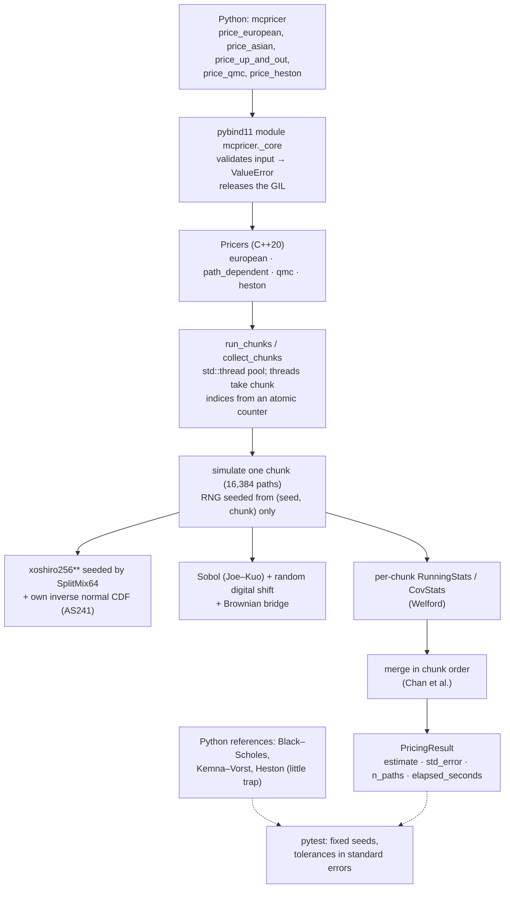
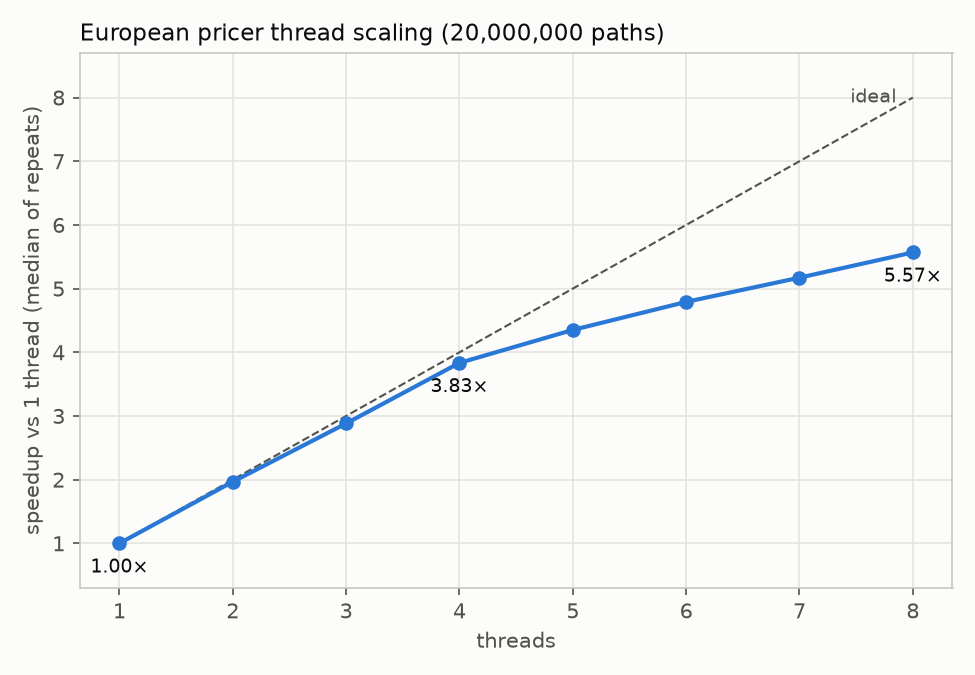
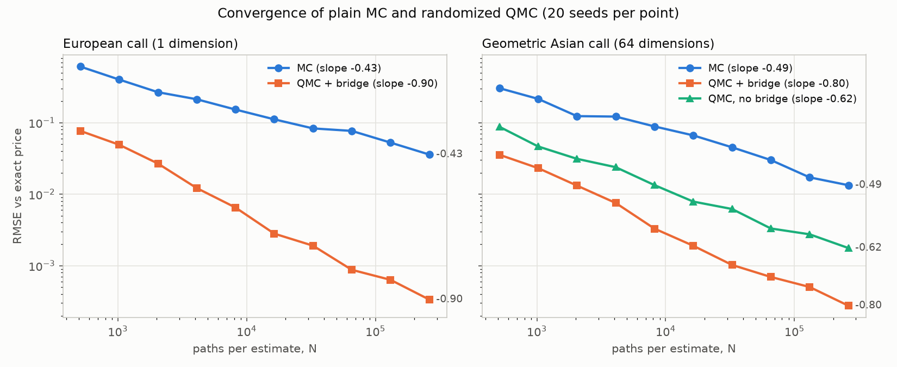
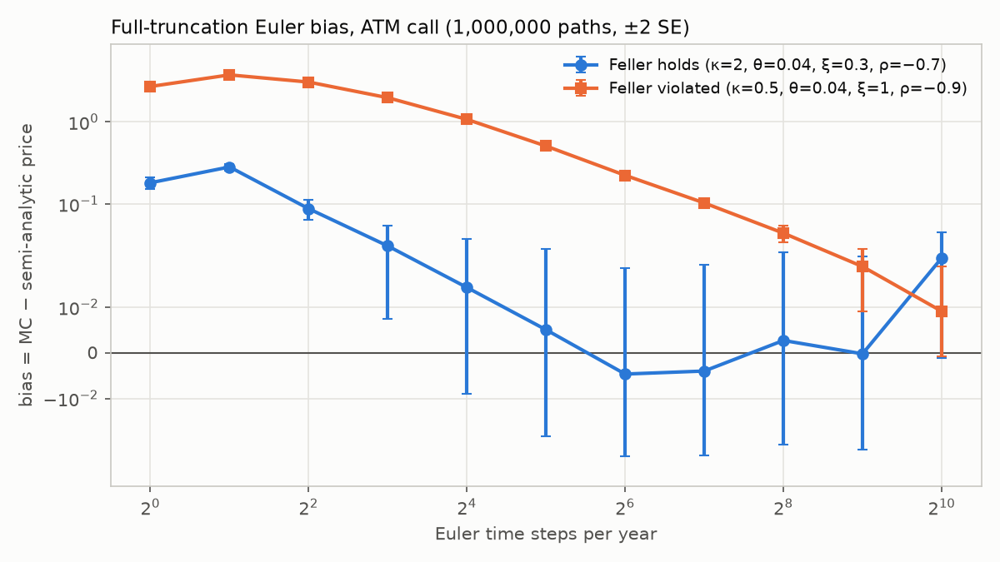

# Monte Carlo Pricing Engine

[](https://github.com/SohamMessi10/Monte-Carlo-Pricing-Engine/actions/workflows/ci.yml)

A C++20 Monte Carlo option-pricing engine with Python bindings (`mcpricer`): multithreaded with
`std::thread`, bit-identical for any thread count, with variance reduction, path-dependent
products, randomized quasi-Monte Carlo and the Heston model. Every price is checked against a
closed-form or semi-analytic reference in tests, and every number below was measured; the full
outputs, with hardware, compiler and flags, are in [`benchmarks/results/`](benchmarks/results/).

## Highlights

Measured on an Apple M3 (4 performance + 4 efficiency cores), AppleClang 17, `-O3`:

- **Throughput:** 50.5 M paths/s on one thread for a European call; 5.57× on 8 threads
  (3.83× on the 4 performance cores), with bit-identical results at every thread count.
- **Variance reduction:** antithetic + control variate cut the variance of an ATM call
  28.8× (513× in the money) at the same path count.
- **Quasi-Monte Carlo:** randomized Sobol with a Brownian bridge reaches 107× lower RMSE than
  plain MC at 262,144 paths on a European call (fitted slope −0.90 vs −0.43), 48× lower on a
  64-step Asian.
- **Heston:** full-truncation Euler bias measured against a semi-analytic price from 1 to 1024
  steps, including a Feller-violating case that needs ~1000 steps to get within 2 SE.
- **Testing:** 340 tests with fixed seeds and tolerances in standard errors; CI on Ubuntu and
  macOS plus an AddressSanitizer + UndefinedBehaviorSanitizer job.

## The maths in one page

**Risk-neutral pricing.** A derivative's price is the discounted expected payoff under the
risk-neutral measure, V = e^{−rT} E[f(S)]. Monte Carlo averages f over n simulated paths; the
estimate's standard error is s/√n (s = sample standard deviation), so error falls as n^{−1/2}
whatever the dimension.

**GBM, exact.** S_T = S_0 exp((r − σ²/2)T + σ√T Z), Z ~ N(0, 1). Path-dependent products use
the grid t_i = iT/m and the same formula step by step, so there is no discretization error.

**Antithetic variates.** Pair every Z with −Z and average the two payoffs. For a monotone payoff
the pair is negatively correlated, so the pair average has lower variance than two independent
draws. The standard error comes from the i.i.d. pair averages.

**Control variates.** With a control X of known mean (here S_T, mean S_0 e^{rT}):

  Ȳ(b) = Ȳ − b (X̄ − E[X]),  b* = Cov(X, Y) / Var(X),  Var(Ȳ(b*)) = Var(Ȳ)(1 − ρ²).

b is estimated from the same paths (O(1/n) bias). The arithmetic Asian uses the geometric
Asian as its control: log G is normal, so its price has a closed form (Kemna–Vorst; discrete
monitoring gives mean log S_0 + (r − σ²/2)T(m+1)/(2m) and variance σ²T(m+1)(2m+1)/(6m²)).

**Barrier.** Up-and-out, monitored at the grid dates. A knocked-out path still draws all its
normals, so a given seed produces the same paths for every barrier level.

**Randomized QMC.** Sobol points (Joe–Kuo direction numbers) fill the unit cube more evenly than
random points, so the error can fall nearly as n^{−1}. An unrandomized Sobol estimate is
deterministic and has no usable error estimate, so each replication XORs every coordinate with
a random 32-bit integer (random digital shift). Each replication is then an unbiased estimate,
and R independent replications give a standard error sd/√R. A **Brownian bridge** builds
W(T) first, then midpoints, so the best-distributed coordinates fix the path's large-scale shape.

**Heston.** dv = κ(θ − v)dt + ξ√v dW_2 with corr(dW_1, dW_2) = ρ. Euler can push v below zero;
**full truncation** keeps v as simulated but uses v⁺ = max(v, 0) in the drift and diffusion
(Lord, Koekkoek & van Dijk 2010). The reference price uses the "little Heston trap"
characteristic function (Albrecher et al. 2007), which avoids the branch-cut jumps of the
original formula, and Gil-Pelaez inversion with `scipy.integrate.quad`.

## Architecture



**Why the result does not depend on the thread count.** Each chunk's random numbers depend only
on (seed, chunk index), never on which thread runs it. Floating-point addition is not
associative, so threads never accumulate into a shared total: each chunk writes its statistics
to its own slot, and the slots are merged in chunk order after `join()`.

**Why our own normal generator.** `std::normal_distribution` is implemented differently in
libc++ and libstdc++, so the same seed gives different numbers on macOS and Linux. We map
uniforms through Wichura's AS241 inverse CDF instead, so every platform runs the same algorithm.

## Install

Requires a C++20 compiler, CMake ≥ 3.26 and Python ≥ 3.11 (pip ≥ 25.1 for `--group`).

```bash
git clone https://github.com/SohamMessi10/Monte-Carlo-Pricing-Engine.git
cd Monte-Carlo-Pricing-Engine
python3 -m venv .venv
source .venv/bin/activate
python -m pip install --upgrade pip
python -m pip install --group dev
python -m pip install --no-build-isolation -e .
python -m pytest
```

The package has no runtime dependencies; the semi-analytic `mcpricer.heston()` reference needs
scipy (`pip install ".[reference]"` from a checkout, or the `dev` group above).

## Usage

```python
import mcpricer
from mcpricer import Average, OptionType, Payoff

terms = dict(spot=100.0, strike=100.0, rate=0.05, vol=0.2, maturity=1.0)

r = mcpricer.price_european(
    option_type=OptionType.CALL,
    **terms,
    n_paths=1_000_000,
    seed=42,
    antithetic=True,
    control_variate=True,
)
print(r.estimate, r.std_error, r.n_paths, r.elapsed_seconds)
print(mcpricer.black_scholes(option_type=OptionType.CALL, **terms))

asian = mcpricer.price_asian(
    option_type=OptionType.CALL, **terms, n_steps=12, n_paths=500_000, seed=1, control_variate=True
)
barrier = mcpricer.price_up_and_out(
    option_type=OptionType.CALL, **terms, barrier=130.0, n_steps=252, n_paths=500_000, seed=1
)
qmc = mcpricer.price_qmc(
    option_type=OptionType.CALL,
    **terms,
    n_steps=64,
    n_points=2**14,
    n_replications=16,
    seed=1,
    payoff=Payoff.ARITHMETIC_ASIAN,
)
heston = mcpricer.price_heston(
    option_type=OptionType.CALL,
    spot=100.0,
    strike=100.0,
    rate=0.03,
    maturity=1.0,
    v0=0.04,
    kappa=2.0,
    theta=0.04,
    xi=0.3,
    rho=-0.7,
    n_steps=200,
    n_paths=500_000,
    seed=1,
)
```

Every pricer takes `n_threads` (0 = one per hardware thread) and returns the estimate, its
standard error, the number of paths and the elapsed time. Invalid input raises `ValueError`.

## Results

All numbers below come from `python benchmarks/run_all.py` on code commit 635a169: Apple M3
(4 performance + 4 efficiency cores), macOS 15.5, AppleClang 17.0.0.17000013, Release
`-O3 -DNDEBUG`, Python 3.13.18, NumPy 2.5.4. Timings are medians of 5 repeats. Full outputs:
[`benchmarks/results/`](benchmarks/results/).

### Thread scaling

European call, 20,000,000 paths:

| threads | median s | M paths/s | speedup |
|--------:|---------:|----------:|--------:|
|       1 |   0.3959 |      50.5 |    1.00 |
|       2 |   0.2013 |      99.4 |    1.97 |
|       4 |   0.1033 |     193.7 |    3.83 |
|       8 |   0.0711 |     281.3 |    5.57 |

Every run was bit-identical to the one-thread result. Scaling is close to linear up to 4
threads; threads 5–8 most likely land on the slower efficiency cores (not separately measured).



### Variance reduction

1,000,000 paths, seed 42. VRF = (plain SE / method SE)², at equal path counts.

| option           | antithetic | control (S_T) | both  |
|------------------|-----------:|--------------:|------:|
| call K=80 (ITM)  |       8.73 |         64.00 | 513.51|
| call K=100 (ATM) |       2.00 |          6.87 | 28.79 |
| call K=130 (OTM) |       1.08 |          1.68 | 13.30 |
| put K=100 (ATM)  |       1.71 |          2.38 |  9.98 |

The control variate weakens out of the money, where the payoff is less linear in S_T. The ATM
call and put get identical standard errors under the control (0.00561): call − put = S_T − K is
linear in the control, so the regression removes exactly that difference.

### Quasi-Monte Carlo

RMSE over 20 seeds against the exact price; N = paths per estimate (QMC: 2 random shifts of
N/2 points).

| product                        | method         | fitted slope | RMSE at N = 262,144 |
|--------------------------------|----------------|-------------:|--------------------:|
| European call (1 dimension)    | MC             |       −0.429 |           3.581e-02 |
| European call (1 dimension)    | QMC            |       −0.900 |           3.353e-04 |
| Geometric Asian (64 dimensions)| MC             |       −0.491 |           1.335e-02 |
| Geometric Asian (64 dimensions)| QMC + bridge   |       −0.803 |           2.757e-04 |
| Geometric Asian (64 dimensions)| QMC, no bridge |       −0.618 |           1.766e-03 |



### Heston discretization bias

ATM call, 1,000,000 paths, bias = MC − semi-analytic price (selected rows).

| steps | Feller holds: bias (SE units) | Feller violated: bias (SE units) |
|------:|------------------------------:|---------------------------------:|
|     4 |                +0.0878 (+7.4) |                  +3.0528 (+295.3) |
|    16 |                +0.0143 (+1.2) |                  +1.0725 (+169.7) |
|    64 |                −0.0047 (−0.4) |                   +0.2237 (+43.4) |
|   256 |                +0.0027 (+0.2) |                    +0.0443 (+9.0) |
|  1024 |                +0.0221 (+1.9) |                    +0.0091 (+1.8) |

Feller holds: κ = 2, θ = 0.04, ξ = 0.3, ρ = −0.7. Feller violated: κ = 0.5, θ = 0.04, ξ = 1,
ρ = −0.9 (v0 = 0.04 for both). When the variance often touches zero the bias falls by about
2.1–2.4× per doubling of steps and needs ~1000 steps to get within 2 SE.



### C++ against vectorized NumPy

Same estimator and path count, wall-clock time from Python:

| product                        | NumPy   | C++, 1 thread   | C++, 8 threads  |
|--------------------------------|--------:|----------------:|----------------:|
| European call, 10M paths       | 0.117 s | 0.198 s (0.59×) | 0.034 s (3.42×) |
| Arithmetic Asian, 64 steps, 1M | 0.650 s | 0.643 s (1.01×) | 0.128 s (5.09×) |

Single-threaded, NumPy is **faster** on the European call and level on the Asian; the C++
speedup comes from multithreading. NumPy draws normals with the ziggurat method, while this
engine uses an inverse CDF to stay deterministic across platforms; that is the likely cause,
but it has not been profiled.

## Testing strategy

- **Against closed forms, in standard errors.** Every Monte Carlo price must be within 4
  standard errors of Black–Scholes, Kemna–Vorst, a single-date barrier formula or the Heston
  reference. Seeds are fixed, so every test is deterministic; tolerances are in SE units, not
  absolute numbers that drift with path counts.
- **Exact checks where they exist.** First 10 Sobol points equal Joe–Kuo's published output;
  all 1024 Sobol dimensions are stratified; the control variate is exact for a linear payoff;
  one Euler step of Heston is Black–Scholes with vol √v0; AS241 matches `scipy.special.ndtri`.
- **Structural properties.** Put–call parity; arithmetic ≥ geometric Asian on the same paths;
  barrier price monotone in the barrier; QMC beats MC; Heston bias shrinks with steps.
- **Determinism.** Bit-identical results for 1, 2, 3, 4 and 8 threads; concurrent calls from
  Python threads.
- **Input validation.** Every invalid parameter raises a `ValueError` naming it.
- **CI.** Ruff; build with warnings as errors and test on Ubuntu and macOS (Python 3.11 and
  3.13); a Linux job running the whole suite with AddressSanitizer + UndefinedBehaviorSanitizer;
  and a ThreadSanitizer job: a standalone C++ program (`tests/cpp/tsan_test.cpp`, no Python, so
  everything it runs is instrumented) that runs every multithreaded pricer and checks 1 and 8
  threads give identical bits.

## Limitations

- Single-threaded, the European pricer is slower than vectorized NumPy (0.59×); not profiled.
- Heston uses Euler: with the Feller condition badly violated it needs ~1000 steps per year.
- QMC supports up to 1024 dimensions (time steps) and 2^32 points per replication; 32-bit
  Sobol points limit the most extreme normal to about ±6.35 (u ≥ 2^−33).
- Results are bit-identical across thread counts on one machine. All platforms run the same
  algorithms, but `exp`/`log` come from each platform's math library, so bitwise equality
  across operating systems is not guaranteed or tested.
- Each pricing call starts its own threads; for runs of a few milliseconds that start-up is a
  noticeable share of the time (no persistent thread pool).
- QMC accepts any `n_points`, but Sobol's balance properties hold for powers of 2; use those.
- No dividends; barrier monitoring is discrete only, with no continuity correction.
- Antithetic variates are implemented for European options only.
- Benchmarks come from one machine; QMC slopes use 20 seeds per point.

## Future work

- **Greeks** by the pathwise method (delta, vega for Lipschitz payoffs) and the likelihood-ratio
  method (digitals, barriers).
- **Andersen's QE scheme** for Heston, to cut the discretization bias at coarse grids.
- **GPU** path generation (CUDA or Metal); the chunked, counter-based seeding maps directly to
  thread blocks.
- Profile the single-thread loop; try a faster normal generator without losing determinism.
- Broadie–Glasserman–Kou continuity correction for discretely monitored barriers.

## Repository layout

```
cpp/include/mcpricer/   headers: RNG, Sobol, Brownian bridge, stats, thread pool, pricers
cpp/src/                pricers: european, path_dependent, qmc, heston
cpp/bindings/           pybind11 module
src/mcpricer/           Python package and closed-form references
tests/                  pytest suite; tests/cpp/ holds the ThreadSanitizer program
benchmarks/             benchmark scripts, saved results and figures
scripts/                Sobol direction-number header generator
third_party/joe-kuo/    licence for the Joe–Kuo direction numbers
```

## Licence

MIT, see [LICENSE](LICENSE). The Sobol direction numbers are from Joe & Kuo
(https://web.maths.unsw.edu.au/~fkuo/sobol/), used under their BSD-style licence, reproduced in
[`third_party/joe-kuo/LICENSE`](third_party/joe-kuo/LICENSE) and in the generated header.
